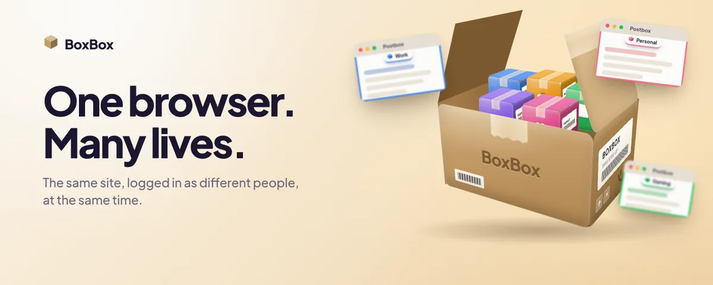
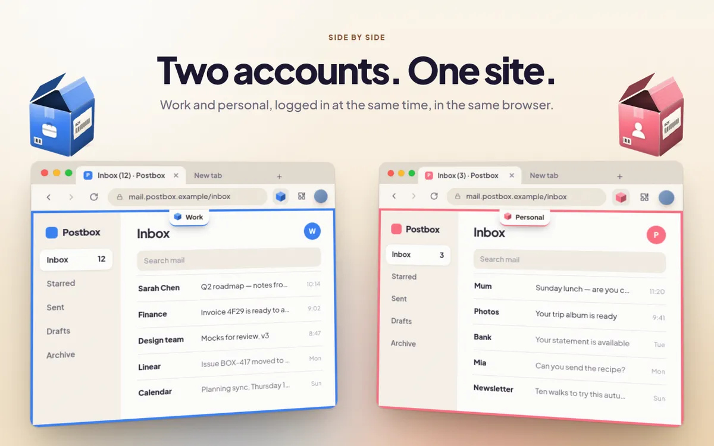
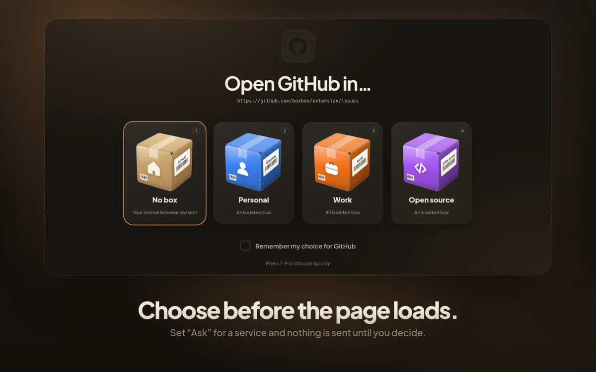
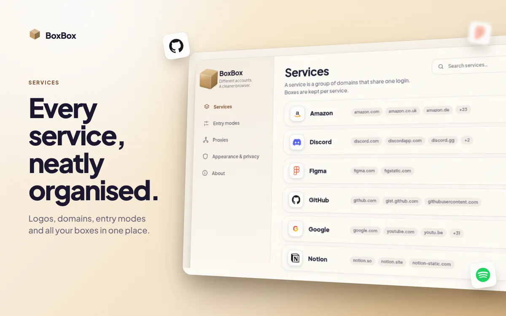
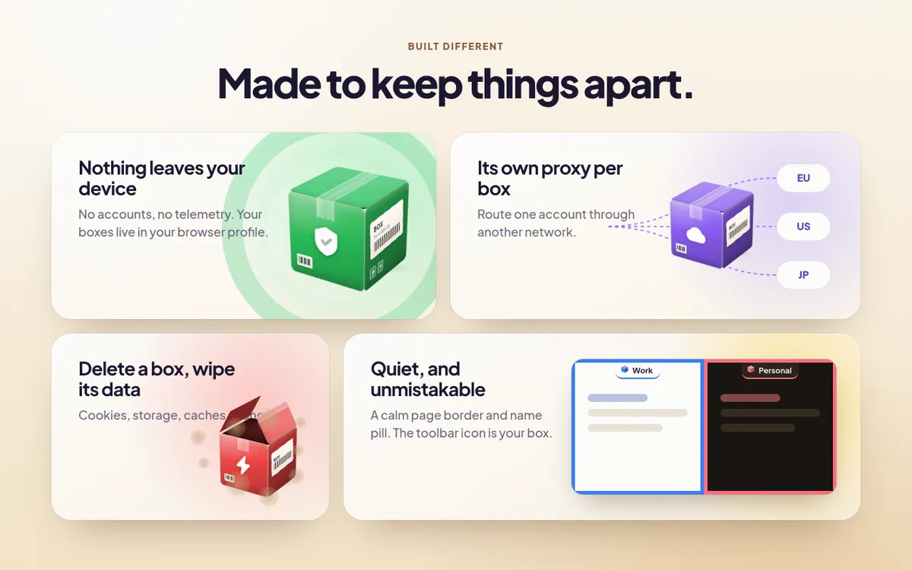

<p align="center">
  
</p>

<h1 align="center">BoxBox</h1>

<p align="center">
  <strong>Log in to the same website as different people, at the same time, in one browser.</strong><br>
  Every account lives in its own little cardboard box.
</p>

<p align="center">
  <a href="#install">Install</a> ·
  <a href="#how-it-feels">How it feels</a> ·
  <a href="#build-it-yourself">Build it yourself</a> ·
  <a href="#faq">FAQ</a> ·
  <a href="#contributing">Contributing</a>
</p>

---

## Why BoxBox?

You have a work Google account and a personal one. Two GitHub identities. A client's dashboard, and your own. Normally that
means signing out and in again, juggling browser profiles, or opening a private window and losing it all when you close it.

BoxBox gives every **tab** its own box. Put one tab in your *Work* box and another in your *Personal* box, and the same site
shows you two different logins side by side. Closing one never signs you out of the other.

- **Works with any website.** No site-specific setup, nothing for the site to support.
- **Your normal browsing is untouched.** Tabs that aren't in a box behave exactly as before.
- **Private by design.** No accounts, no telemetry, nothing is sent anywhere. Your boxes live in your browser profile.
- **Free and open source.**

Supported browsers: **Chrome**, **Firefox** and **Helium**.

## How it feels

### Two accounts. One site.

Open the same site in two boxes and use both at once. Each box has its own name, colour and icon, so you always know where you
are: the toolbar icon *is* your current box, and a calm coloured border and name tag sit on the page.

<p align="center">
  
</p>

### Choose before the page loads

Prefer to decide each time? Set a site to **Ask** and BoxBox shows a picker before anything loads, so the site never sees
the wrong account. Or have it open your normal browser, or remember the last box you used. You can set this for everything,
or per site.

<p align="center">
  
</p>

### Sites, not just domains

BoxBox thinks in *services*. `youtube.com` and `accounts.google.com` are both Google, so moving between them never switches
your box. Popular services come grouped out of the box, and you can merge, split or create your own.

<p align="center">
  
</p>

### Made to keep things apart

<p align="center">
  
</p>

- **Its own proxy per box.** Send one account through a different network or country.
- **Delete a box, wipe its data.** Cookies, storage and caches go with it.
- **Nothing leaves your device.** No sign-up, no analytics, no servers.

## Install

BoxBox is not on the browser stores yet. Until it is, build it (below) and load it in your browser:

| Browser | How to load it |
|---|---|
| **Chrome** | Open `chrome://extensions`, turn on *Developer mode*, click *Load unpacked*, choose the `dist/chrome-mv3` folder. |
| **Firefox** | Open `about:debugging`, choose *This Firefox* → *Load Temporary Add-on…*, select `dist/firefox/manifest.json`. |
| **Helium** | Start it with `--load-extension=dist/chrome-mv2 --disable-features=ExtensionManifestV2Unsupported,ExtensionManifestV2Disabled`. |

> **Note for Chrome users:** tabs inside a box show Chrome's *"BoxBox started debugging this browser"* bar. That is Chrome's
> price for isolating accounts. If you close the bar, the tab is blocked instead of silently falling back to your normal
> session, and the popup offers a *Restore isolation* button.

## Build it yourself

### What you need

Just **[Node.js](https://nodejs.org) 18 or newer** (or **[Bun](https://bun.sh)**). BoxBox has no other build requirements.

### Build

```sh
git clone git@github.com:oxcl/boxbox.git
cd boxbox

npm ci            # install dependencies
npm run build     # build the extension for all browsers
```

With Bun, use `bun install` and `bun run build` instead.

The result lands in `dist/`:

| Folder | For |
|---|---|
| `dist/chrome-mv3` | Chrome |
| `dist/firefox` | Firefox |
| `dist/chrome-mv2` | Helium |

Then load it as described in [Install](#install).

### Optional: the Nix development environment

If you use [Nix](https://nixos.org/download) (with flakes) and [direnv](https://direnv.net), `direnv allow` gives you the whole
toolchain at once: Node, plus the exact browsers and drivers the tests and launchers below use, with nothing installed
globally. Then prefix commands with `direnv exec .`, for example `direnv exec . npm run build`.

### Try it in a throwaway browser

One command builds BoxBox and opens a browser with a brand-new temporary profile that contains only BoxBox. Close the window
and the profile disappears. The browser comes with the Nix environment; without Nix, point `BOX_CHROME`, `BOX_FIREFOX` or `BOX_HELIUM` at your
browser's executable first, for example `BOX_CHROME=/usr/bin/google-chrome npm run launch:chrome`.

```sh
npm run launch:chrome
npm run launch:firefox
npm run launch:helium

# optionally open a page straight away
node scripts/launch.mjs chrome https://www.saucedemo.com/
```

### Package for the stores

```sh
(cd dist/chrome-mv3 && zip -r ../../boxbox-chrome-mv3.zip .)
(cd dist/firefox    && zip -r ../../boxbox-firefox.zip .)
```

The store listing images in `store/out/` are generated with `node scripts/store-assets.mjs`
(run the build first). See [`store/README.md`](store/README.md).

### The website

The project site lives in `website/` (plain HTML, CSS and a little JavaScript; no framework). It reuses the extension's own box
component, logos and service catalog, so it always matches the product.

```sh
npm run build:website    # -> website-dist/
npm run test:website     # loads it in a real browser: errors, links, interactions, phone layout, load speed
```

Pushing a change under `website/` to `main` publishes it to GitHub Pages (the `website` branch) through
`.github/workflows/deploy-website.yml`. The store links on the site are set in `website/site.config.json`.

### Run the tests

```sh
npm test                # unit tests, then the full suite on Firefox, Chrome and Helium
npm run test:unit       # just the quick unit tests
npm run test:chrome     # one browser (also: test:firefox, test:helium)
```

The end-to-end tests drive real browsers against a local fixture server, so they need no internet connection. The unit tests
run anywhere; the browser tests are easiest inside the Nix environment, which supplies the browsers and drivers.
`npm run smoke` additionally checks a few real websites as a sanity test.

## FAQ

**Is this the same as browser profiles or containers?**
It's the same idea with less friction: one profile, one window, any mix of boxes tab by tab. On Firefox each box shows up
as a coloured container; on Chrome as a coloured tab group.

**Does it work in private/incognito windows?**
BoxBox leaves private windows alone.

**Will it slow my browser down?**
Tabs outside a box are not touched. The interface is lightweight and only animates while something is moving.

**What does BoxBox know about me?**
Nothing leaves your machine. To show a service's logo in Settings, it remembers the icon a page you visit has already
loaded, stored locally. Logos for popular services are bundled with the extension.

## Learn more

- [DESIGN.md](DESIGN.md) — how BoxBox works under the hood.
- [REPORT.md](REPORT.md) — what works, what doesn't, and the test evidence.
- [`prototype/`](prototype/index.html) — the standalone design prototype the interface grew from.

## Contributing

Bug reports, ideas and pull requests are welcome. Please open an issue first for anything large, and run
`npm test` before sending a change.

## License

BoxBox is free software, licensed under the [GNU General Public License v3.0](LICENSE) (GPL-3.0-only).

## Credits

Service logos come from [simple-icons](https://simpleicons.org) (CC0), plus a few hand-made marks. They are used only to
identify a service; the brands belong to their owners.
